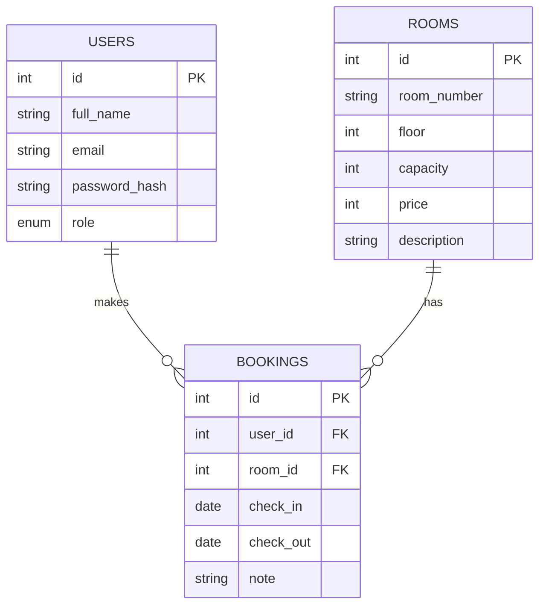

# 🏠 Жатақхана бөлмелерін брондау жүйесі

PHP + MySQL қолданып жасалған веб-қосымша. Студент жатақханадағы бөлмені көреді, іздейді, күнді таңдап брондайды. Әкімші бөлмелерді басқарады.

## Жобаның мақсаты
Жатақхана бөлмелерін қолмен жазып брондау ыңғайсыз. Бұл жүйе бөлмелердің бос-бос еместігін автоматты тексеріп, брондауды онлайн жасауға мүмкіндік береді.

## Мүмкіндіктер
- Тіркелу, кіру, шығу (`password_hash`, сессия)
- Бөлмелер тізімі: іздеу, қабат бойынша сүзу, баға бойынша сұрыптау, пагинация
- Брондау (күндердің қиылысуын тексеру)
- Өз брондарын көру, өзгерту, жою (CRUD)
- Админ панелі: бөлмелерді қосу / өзгерту / жою (рөлдер: user / admin)
- Қауіпсіздік: PDO prepared statements, `htmlspecialchars` (XSS), CSRF токен, сервер жағында валидация

## Беттер тізімі
| Бет | Сипаттама |
|---|---|
| index.php | Бөлмелер, іздеу, сүзгі, пагинация |
| register.php / login.php / logout.php | Аутентификация |
| book.php | Жаңа брондау |
| my_bookings.php | Менің брондарым (Read, Delete) |
| edit_booking.php | Брондауды өзгерту (Update) |
| admin/rooms.php | Бөлмелерді басқару (тек админ) |

## ER-диаграмма

## Орнату
1. XAMPP / OpenServer ішінде Apache және MySQL қосыңыз.
2. phpMyAdmin арқылы `database.sql` файлын импорттаңыз.
3. `config.php` ішінде дерекқор деректерін тексеріңіз.
4. Жоба қалтасын `htdocs`-қа салыңыз (қалта ішінде тұрса, `config.php`-дағы `BASE`-ті `'/dorm-booking'` деп қойыңыз).
5. `http://localhost/dorm-booking/` ашыңыз.
6. Админ жасау үшін: тіркеліп алып, phpMyAdmin-де
   `UPDATE users SET role='admin' WHERE email='сіздің@email';`

## Технологиялар
PHP 8, MySQL, PDO, HTML, CSS, JavaScript
